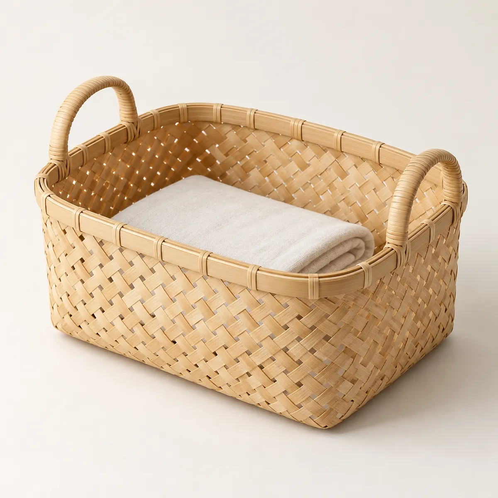
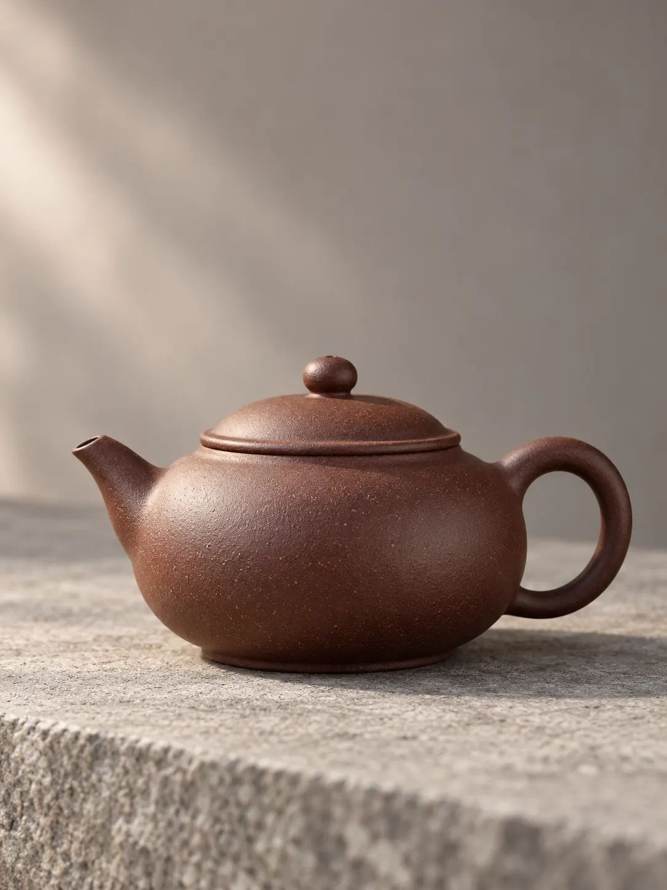
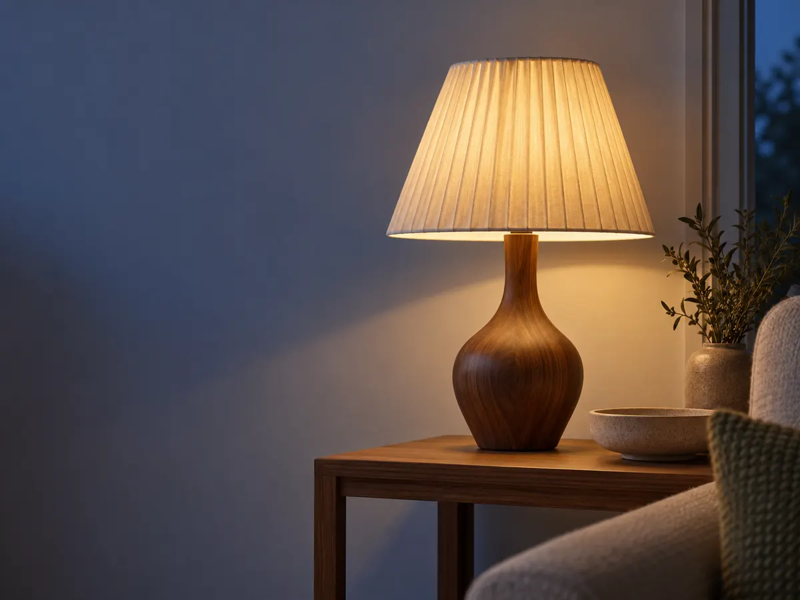
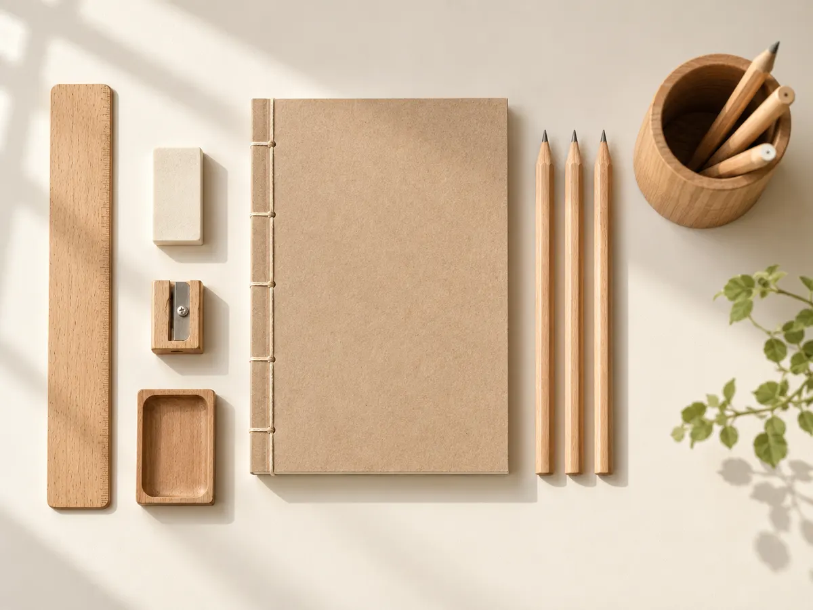
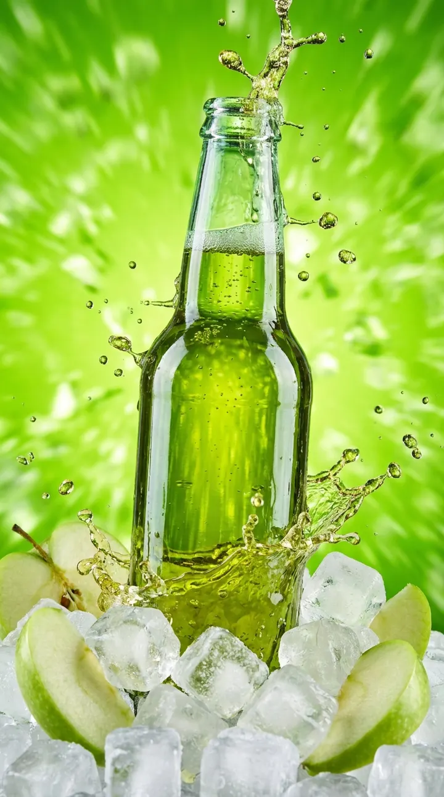
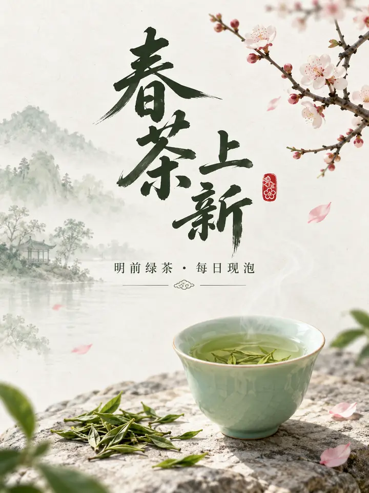
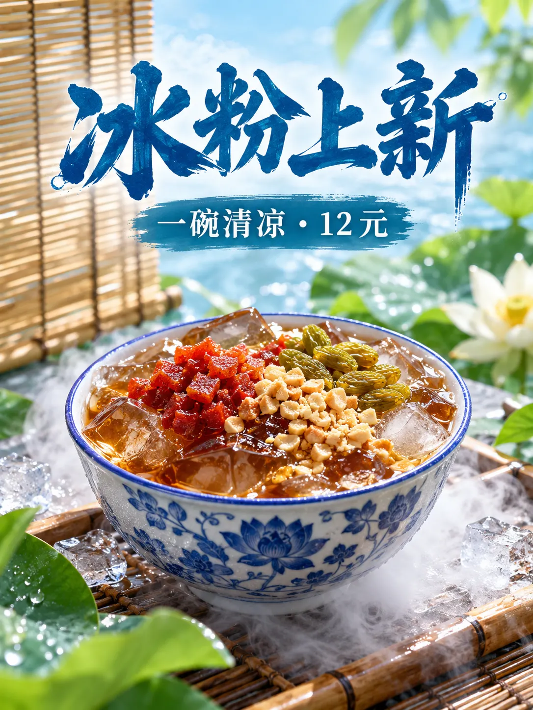

# E-commerce Product Photo Prompts

Copy-ready prompts for product photos — catalog shots, lifestyle scenes, ad creatives, and on-model shots. Every prompt comes with the image it actually produced, so you can see what to expect before you spend a credit.

**20 prompts** · last updated 2026-11-24 · new prompts added weekly

[中文说明](README.zh.md) · [License](LICENSE)

## How to use

1. Pick a prompt below and copy it as is.
2. Change the product noun, colors and materials to match your item; keep the rest (background, light, the "no text / no logos" line).
3. Use it in any image model that takes text prompts (GPT Image, Nano Banana, Seedream, Midjourney, Flux, ...). Results differ between models; the sample image shows one real output, not a guarantee.
4. For the *edit* prompts, upload your own photo first, then paste the prompt.

## What these prompts have in common

Most prompts here are built in the same order:

- **Subject first, unbranded**: "a single unbranded rust-orange hiking backpack" — say what it is, its color and material.
- **Setting and background**: "seamless light-gray background", "pale stone studio plinth", "ivory linen".
- **Light**: "broad softbox lighting", "soft morning side light", "warm rim light".
- **What to show clearly**: "visible stitching, straps and zipper pulls", "show glaze variation and believable contact shadows".
- **Framing**: "keep the entire bag inside the frame", "empty space on the left for copy".
- **A closing exclusion line**: "No people, labels, text, logos or recognizable branded design."
- **For edits, say what must not change**: "Keep the mug, its angle and lighting direction unchanged."

## Contents

- [Clean catalog shots (plain or white background)](#01-clean-catalog-shots-plain-or-white-background) — 5 · [file](prompts/01-clean-catalog.md)
- [Lifestyle scenes and flat lays](#02-lifestyle-scenes-and-flat-lays) — 4 · [file](prompts/02-lifestyle.md)
- [Ad creatives](#03-ad-creatives) — 5 · [file](prompts/03-ad-creative.md)
- [Mockup sets and holiday gift shots](#04-mockup-sets-and-holiday-gift-shots) — 2 · [file](prompts/04-mockup-holiday.md)
- [On-model shots](#05-on-model-shots) — 2 · [file](prompts/05-on-model.md)
- [Shop posters with text (Chinese)](#07-shop-posters-with-text-chinese) — 2 · [file](prompts/07-shop-poster.md)

## 01 Clean catalog shots (plain or white background)

Main listing images: one product, plain seamless background, soft even light, real contact shadow.

### Ceramic Bowl Collection


```text
Create a clean catalog photograph of three original handmade ceramic bowls in chalk white, clay pink and moss green, arranged at different heights on a seamless light-gray background. Show glaze variation and believable contact shadows, crisp edges, broad softbox lighting. No food, people, text, logos or recognizable branded patterns.
```

- Type: text-to-image
- Aspect ratio: `1:1`
- Model preset on the source page: `gpt-image-2`
- Source: `image2ai.cloud/templates/product-photos`

### Trail Backpack Detail


```text
Photograph a single unbranded rust-orange hiking backpack standing on a pale stone studio plinth. Three-quarter view, believable woven fabric, visible stitching, straps and zipper pulls, soft directional light and a muted blue background. Keep the entire bag inside the frame. No people, labels, text, logos or recognizable branded design.
```

- Type: text-to-image
- Aspect ratio: `3:4`
- Model preset on the source page: `gpt-image-2`
- Source: `image2ai.cloud/templates/product-photos`

### 竹编收纳篮主图



```text
原创电商商品摄影，一只无品牌的浅色竹编收纳篮放在米白无缝背景上，四分之三视角，完整展示篮口、提手和细密编织纹理，篮内只放一块折叠素色棉布，柔和棚拍光，真实接触阴影，画面干净。不要人物、文字、标签、品牌标志、水印或可识别的品牌专属造型。
```

- Type: text-to-image
- Prompt language: Chinese (shown as used on the site). What it shows: 竹编收纳篮置于浅色背景上，呈现竹条纹理与编织细节
- Aspect ratio: `1:1`
- Model preset on the source page: `gpt-image-2`
- Source: `image2ai.cloud/zh/templates/product-photos`

### 手工茶壶细节图



```text
原创商品摄影，一把无品牌的紫砂小茶壶放在浅灰石台上，壶盖正常合拢，壶嘴与把手完整入镜，侧后方柔光表现细腻砂粒和温润质感，背景为低饱和暖灰，不摆茶杯，不加装饰文字。不要人物、印章、款识、品牌标志、水印或知名器型的直接复制。
```

- Type: text-to-image
- Prompt language: Chinese (shown as used on the site). What it shows: 手工茶壶的壶身、壶嘴与釉面细节
- Aspect ratio: `3:4`
- Model preset on the source page: `gpt-image-2`
- Source: `image2ai.cloud/zh/templates/product-photos`

### 冰淇淋商品静物


```text
极简静物商品图：银色勺子上一球粉色草莓冰淇淋，暖米色纯色背景，柔和侧光，浅景深，干净的电商风格
```

- Type: text-to-image
- Prompt language: Chinese (shown as used on the site). What it shows: 极简商品图：银色勺子上一球粉色草莓冰淇淋，暖米色纯色背景
- Aspect ratio: `3:4`
- Model preset on the source page: `nano-banana-2`
- Source: `image2ai.cloud/zh/templates/product-photos`

## 02 Lifestyle scenes and flat lays

Show the product in use or in a styled setting: flat lays, interiors, mood lighting.

### Handmade Soap Flat Lay


```text
Create an original overhead product photograph of three unbranded handmade oat soap bars on ivory linen, with scattered oats and a small wooden tray. Show the cut texture clearly, soft morning side light, warm neutral colors, generous space between objects. No people, packaging text, logos, watermarks or recognizable branded shapes.
```

- Type: text-to-image
- Aspect ratio: `1:1`
- Model preset on the source page: `gpt-image-2`
- Source: `image2ai.cloud/templates/product-photos`

### Sculptural Table Lamp



```text
Create an original interior product photograph of an unbranded sculptural table lamp with a cream pleated shade and walnut base on a simple side table. Warm lamp glow against a cool dusk wall, realistic fabric and wood grain, restrained styling, empty space to the left. No people, lettering, logos or recognizable designer-product replicas.
```

- Type: text-to-image
- Aspect ratio: `4:3`
- Model preset on the source page: `gpt-image-2`
- Source: `image2ai.cloud/templates/product-photos`

### Perfume on wet stones


```text
Unbranded amber glass perfume bottle on wet black stones, gentle ripples, warm rim light and teal background glow, luxury ad look, empty space on the left for copy
```

- Type: text-to-image
- Aspect ratio: `16:9`
- Model preset on the source page: `nano-banana-pro`
- Source: `image2ai.cloud/templates/product-photos`

### 原木文具俯拍



```text
原创电商俯拍图，一套无品牌原木文具整齐摆在暖白桌面上，包括木尺、无字封面的线装笔记本、素色铅笔和小号木笔筒，各物件之间留出清晰间隔，柔和窗光，真实木纹，克制的米棕配色。尺面不写数字，笔记本与铅笔不写字，不要人物、品牌标志或水印。
```

- Type: text-to-image
- Prompt language: Chinese (shown as used on the site). What it shows: 原木文具整齐排列的俯拍静物
- Aspect ratio: `4:3`
- Model preset on the source page: `gpt-image-2`
- Source: `image2ai.cloud/zh/templates/product-photos`

## 03 Ad creatives

Splash shots, exploded views and styled still lifes for ads and hero banners.

### Protein shake splash ad


```text
Hyper-real product ad: a matte blue protein shake bottle labeled "PEAKLINE" leaning into a creamy milk splash with blueberries, condensation drops, studio light
```

- Type: text-to-image
- Aspect ratio: `3:4`
- Model preset on the source page: `gpt-image-2`
- Source: `image2ai.cloud/templates/product-photos`

### Exploded headphones


```text
Exploded view of unbranded over-ear headphones: ear cups, drivers, cushions, circuit board and screws floating in perfect alignment on a white seamless background
```

- Type: text-to-image
- Aspect ratio: `1:1`
- Model preset on the source page: `nano-banana-pro`
- Source: `image2ai.cloud/templates/product-photos`

### 气泡酒飞溅广告



```text
苹果气泡酒商品广告：绿色玻璃瓶立在冰块和青苹果片中，酒液向四周飞溅，亮绿色背景，高速摄影质感，瓶身不出现文字
```

- Type: text-to-image
- Prompt language: Chinese (shown as used on the site). What it shows: 绿色玻璃瓶苹果气泡酒立在冰块和青苹果片中，酒液向四周飞溅的商品广告图
- Aspect ratio: `9:16`
- Model preset on the source page: `nano-banana-pro`
- Source: `image2ai.cloud/zh/templates/product-photos`

### 口红甜品挞静物


```text
复古静物广告：红格子桌布上一只樱桃甜品挞，两支红色口红插在奶油上，红丝带和樱桃散落，天蓝色背景，明亮硬光
```

- Type: text-to-image
- Prompt language: Chinese (shown as used on the site). What it shows: 复古静物广告：红格子桌布上的樱桃甜品挞，两支红色口红插在奶油上，天蓝色背景
- Aspect ratio: `4:3`
- Model preset on the source page: `nano-banana-2`
- Source: `image2ai.cloud/zh/templates/product-photos`

### 折叠雨伞雨滴广告


```text
原创商品广告，一把无品牌的深青色折叠雨伞完全撑开，伞柄朝下，完整悬置在浅蓝灰背景中央，伞面布料纹理清晰，少量晶莹雨滴附着，斜向柔光表现防雨质感，构图简洁可信，不做液体飞溅。不要人物、文字、品牌标志、复杂花纹或水印。
```

- Type: text-to-image
- Prompt language: Chinese (shown as used on the site). What it shows: 带有雨滴的折叠雨伞商品广告图
- Aspect ratio: `3:4`
- Model preset on the source page: `gpt-image-2`
- Source: `image2ai.cloud/zh/templates/product-photos`

## 04 Mockup sets and holiday gift shots

One product across several scenes in one image, and seasonal gift-box key visuals.

### Skincare mockup grid


```text
3x3 grid of designer mockups for one frosted sage-green dropper bottle labeled "VERDA": on stone, in water, with botanicals, in hand, flat lay
```

- Type: text-to-image
- Aspect ratio: `3:4`
- Model preset on the source page: `nano-banana-2`
- Source: `image2ai.cloud/templates/product-photos`

### 中秋月饼礼盒主图


```text
中秋月饼礼盒电商主图：深红礼盒配金色云纹，六个金黄月饼，切开一个看到莲蓉和咸蛋黄，背景圆月和桂花，金色书法“月满人团圆”
```

- Type: text-to-image
- Prompt language: Chinese (shown as used on the site). What it shows: 深红色中秋月饼礼盒电商主图，盒里六个金黄月饼，背景圆月，金色书法“月满人团圆”
- Aspect ratio: `1:1`
- Model preset on the source page: `nano-banana-2`
- Source: `image2ai.cloud/zh/templates/product-photos`

## 05 On-model shots

Beauty close-ups and putting your garment on a model photo you already have.

### Lipstick beauty close-up


```text
High-end beauty ad close-up: a model with wet-look short blonde hair and freckles holds a silver lipstick near her glossy lips, soft frontal light, off-white background
```

- Type: text-to-image
- Aspect ratio: `16:9`
- Model preset on the source page: `nano-banana-2`
- Source: `image2ai.cloud/templates/product-photos`

### 水光肌美妆特写


```text
美妆广告特写：短发女生手拿口红贴近嘴唇，皮肤水润有光泽，米白背景，柔和正面光，干净高级
```

- Type: text-to-image
- Prompt language: Chinese (shown as used on the site). What it shows: 美妆广告特写：短发女生手拿口红贴近嘴唇，皮肤水润，米白背景
- Aspect ratio: `16:9`
- Model preset on the source page: `nano-banana-2`
- Source: `image2ai.cloud/zh/templates/product-photos`

## 07 Shop posters with text (Chinese)

Promotional posters with headline text rendered in the image. Both prompts are in Chinese.

### 新中式春茶海报



```text
新中式茶饮海报：青瓷杯里的绿茶冒着热气，米色宣纸背景，几片茶叶和一枝梅花，书法大标题“春茶上新”，小字“明前绿茶 · 每日现泡”，红色印章点缀，大量留白
```

- Type: text-to-image
- Prompt language: Chinese (shown as used on the site). What it shows: 新中式茶饮海报：青瓷杯里冒热气的绿茶，宣纸底上书法标题“春茶上新”和红色印章
- Aspect ratio: `3:4`
- Model preset on the source page: `gpt-image-2`
- Source: `image2ai.cloud/zh/templates/posters`

### 夏日冰粉新品海报



```text
夏日甜品店新品海报：青花瓷碗里一份红糖冰粉，配山楂碎、葡萄干和花生碎，碗边冒着冷气，背景是竹帘和绿荷叶，大字“冰粉上新”，小字“一碗清凉 · 12 元”，清爽蓝绿配色
```

- Type: text-to-image
- Prompt language: Chinese (shown as used on the site). What it shows: 青花瓷碗里的红糖冰粉，大字“冰粉上新”
- Aspect ratio: `3:4`
- Model preset on the source page: `gpt-image-2`
- Source: `image2ai.cloud/zh/templates/posters`

## About the samples

Every sample image and prompt in this repo is taken from the public examples on https://image2ai.cloud (templates, tool pages and the home page gallery). Prompts are copied word for word; nothing was rewritten or re-generated for this repo. The "model preset" is the model the source page pre-fills for that prompt. Input photos in the edit section are the site's own example inputs. Per-image source page, original file URL and SHA-256 are listed in [data/sources.md](data/sources.md); machine-readable data is in [data/prompts.json](data/prompts.json).

## Contributing

Found a prompt that works well for product photos? Open an issue with the prompt, the model you used and the output image. Please only share prompts and images you have the right to share, and no real brand logos.

## License

Prompt text: CC0 1.0 — copy and adapt freely. Images: see [LICENSE](LICENSE).
