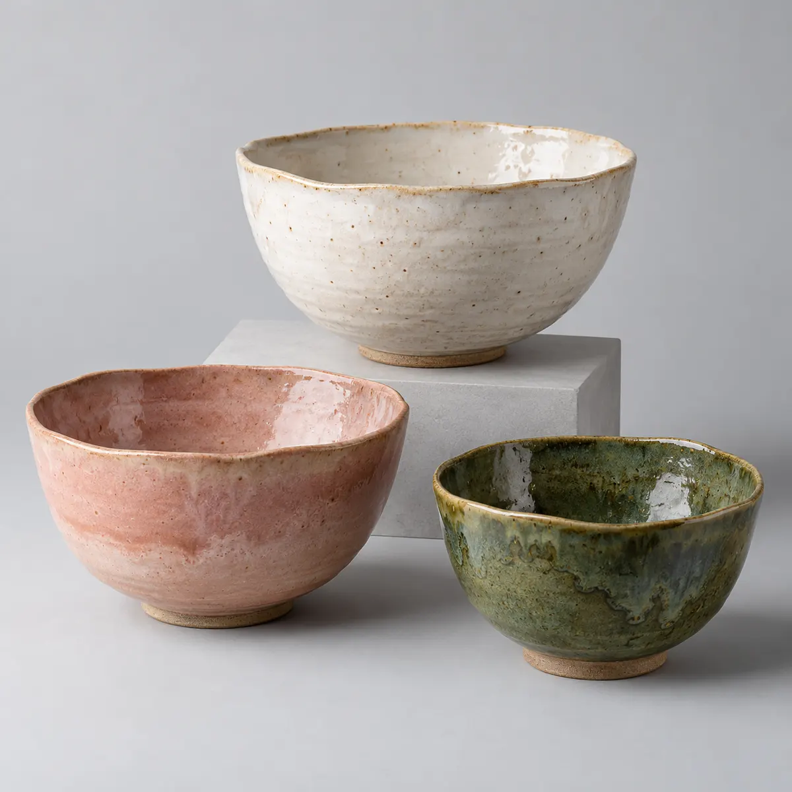
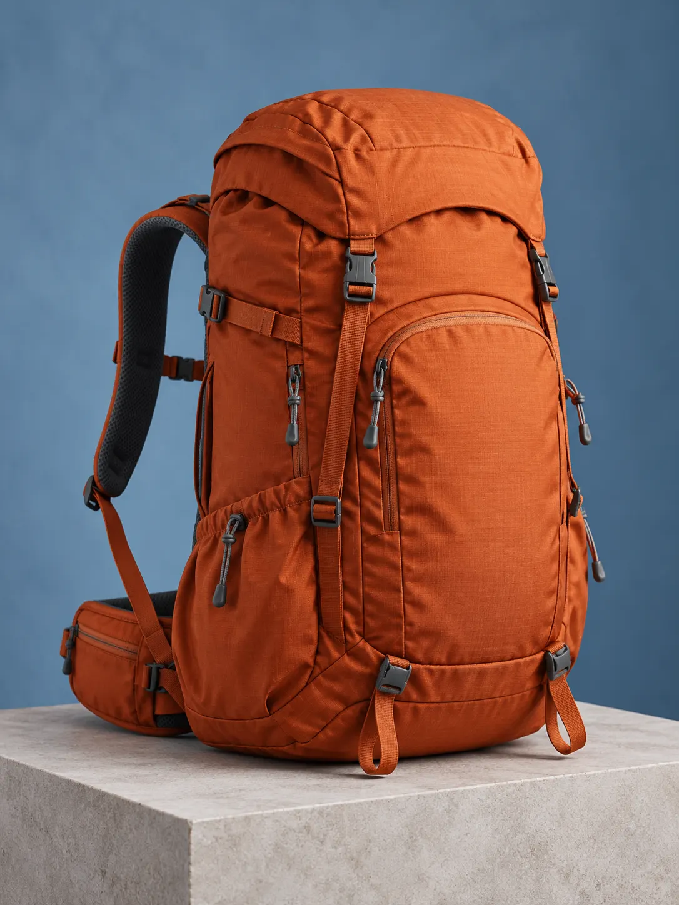
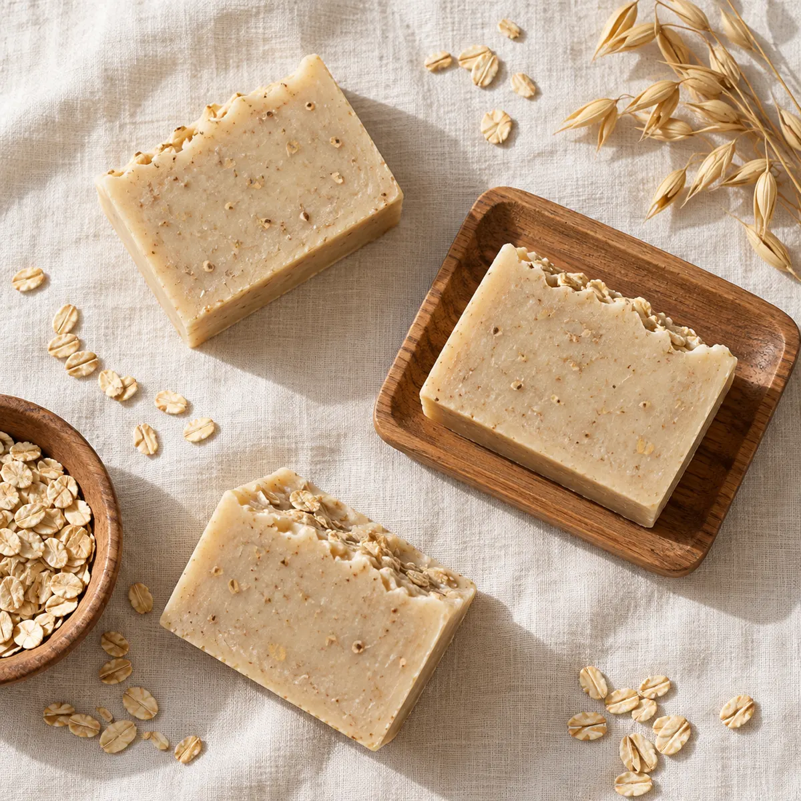
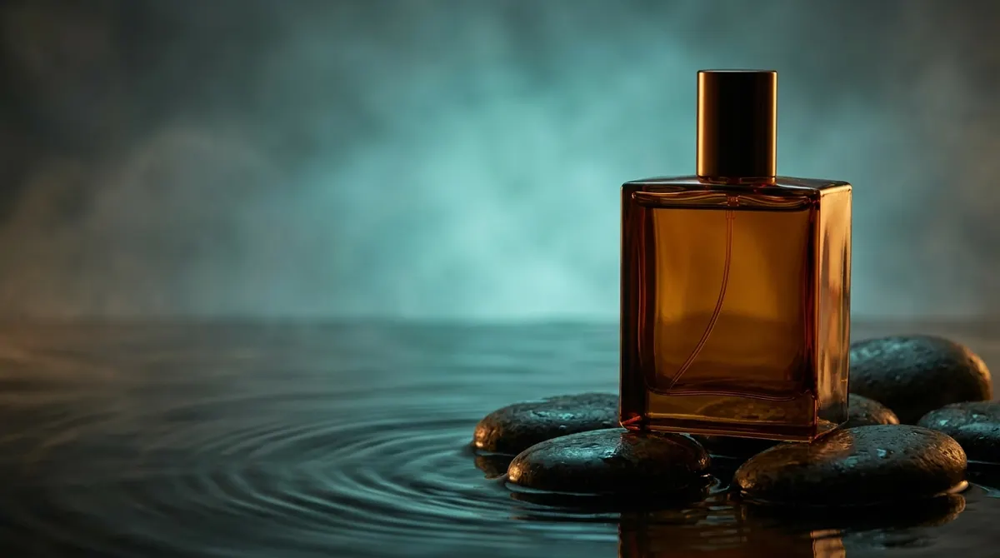
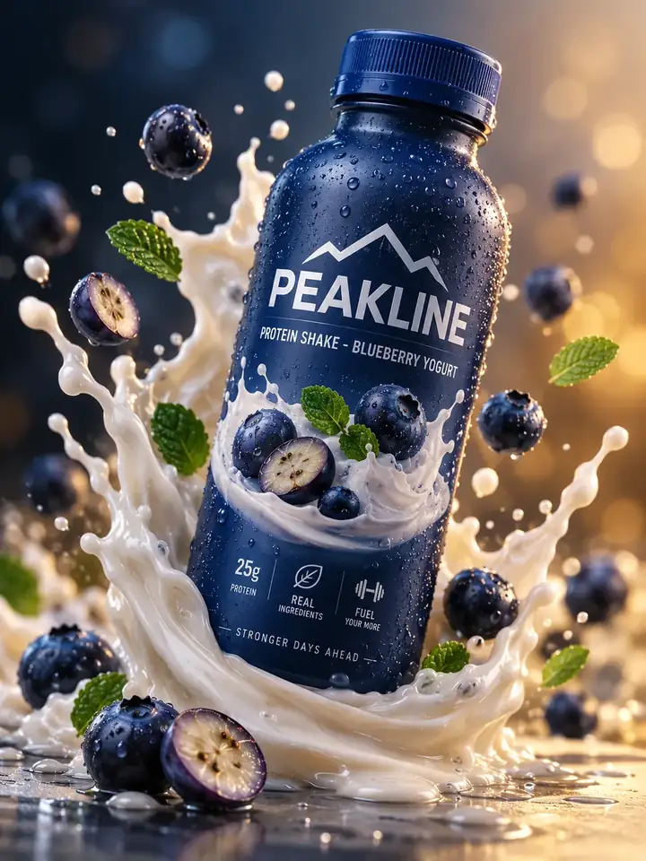
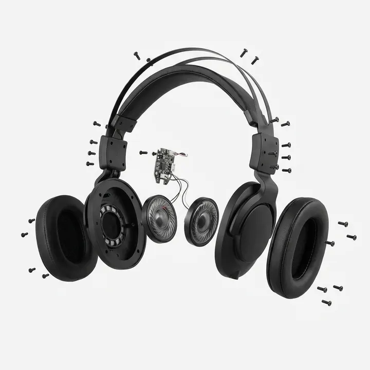
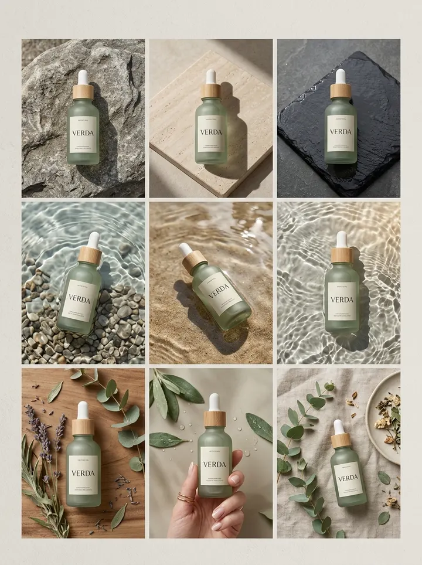
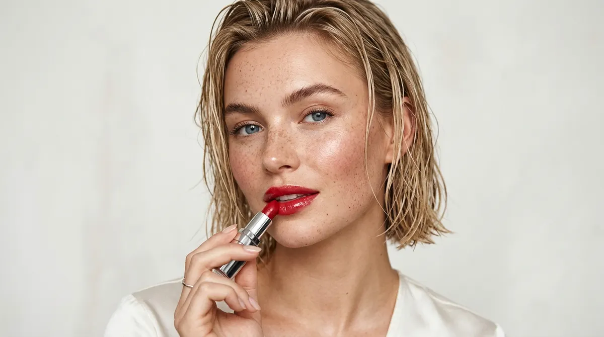

# E-commerce Product Photo Prompts

Copy-ready prompts for product photos — catalog shots, lifestyle scenes, ad creatives, and on-model shots. Every prompt comes with the image it actually produced, so you can see what to expect before you spend a credit.

**9 prompts** · last updated 2026-11-25 · new prompts added weekly

> 中文版 / Chinese version: [README.zh.md](README.zh.md) — 11 条中文提示词 (11 prompts in Chinese).

[License](LICENSE)

## How to use

1. Pick a prompt below and copy it as is.
2. Change the product noun, colors and materials to match your item; keep the rest (background, light, the "no text / no logos" line).
3. Use it in any image model that takes text prompts (GPT Image, Nano Banana, Seedream, Midjourney, Flux, ...). Results differ between models; the sample image shows one real output, not a guarantee.

## What these prompts have in common

Most prompts here are built in the same order:

- **Subject first, unbranded**: "a single unbranded rust-orange hiking backpack" — say what it is, its color and material.
- **Setting and background**: "seamless light-gray background", "pale stone studio plinth", "ivory linen".
- **Light**: "broad softbox lighting", "soft morning side light", "warm rim light".
- **What to show clearly**: "visible stitching, straps and zipper pulls", "show glaze variation and believable contact shadows".
- **Framing**: "keep the entire bag inside the frame", "empty space on the left for copy".
- **A closing exclusion line**: "No people, labels, text, logos or recognizable branded design."

## Contents

- [Clean catalog shots (plain or white background)](#01-clean-catalog-shots-plain-or-white-background) — 2 · [file](prompts/01-clean-catalog.md)
- [Lifestyle scenes and flat lays](#02-lifestyle-scenes-and-flat-lays) — 3 · [file](prompts/02-lifestyle.md)
- [Ad creatives](#03-ad-creatives) — 2 · [file](prompts/03-ad-creative.md)
- [Mockup sets and holiday gift shots](#04-mockup-sets-and-holiday-gift-shots) — 1 · [file](prompts/04-mockup-holiday.md)
- [On-model shots](#05-on-model-shots) — 1 · [file](prompts/05-on-model.md)

## 01 Clean catalog shots (plain or white background)

Main listing images: one product, plain seamless background, soft even light, real contact shadow.

### Ceramic Bowl Collection



```text
Create a clean catalog photograph of three original handmade ceramic bowls in chalk white, clay pink and moss green, arranged at different heights on a seamless light-gray background. Show glaze variation and believable contact shadows, crisp edges, broad softbox lighting. No food, people, text, logos or recognizable branded patterns.
```

- Type: text-to-image
- Aspect ratio: `1:1`
- Model preset on the source page: `gpt-image-2`
- Source: `image2ai.cloud/templates/product-photos`

### Trail Backpack Detail



```text
Photograph a single unbranded rust-orange hiking backpack standing on a pale stone studio plinth. Three-quarter view, believable woven fabric, visible stitching, straps and zipper pulls, soft directional light and a muted blue background. Keep the entire bag inside the frame. No people, labels, text, logos or recognizable branded design.
```

- Type: text-to-image
- Aspect ratio: `3:4`
- Model preset on the source page: `gpt-image-2`
- Source: `image2ai.cloud/templates/product-photos`

## 02 Lifestyle scenes and flat lays

Show the product in use or in a styled setting: flat lays, interiors, mood lighting.

### Handmade Soap Flat Lay



```text
Create an original overhead product photograph of three unbranded handmade oat soap bars on ivory linen, with scattered oats and a small wooden tray. Show the cut texture clearly, soft morning side light, warm neutral colors, generous space between objects. No people, packaging text, logos, watermarks or recognizable branded shapes.
```

- Type: text-to-image
- Aspect ratio: `1:1`
- Model preset on the source page: `gpt-image-2`
- Source: `image2ai.cloud/templates/product-photos`

### Sculptural Table Lamp


```text
Create an original interior product photograph of an unbranded sculptural table lamp with a cream pleated shade and walnut base on a simple side table. Warm lamp glow against a cool dusk wall, realistic fabric and wood grain, restrained styling, empty space to the left. No people, lettering, logos or recognizable designer-product replicas.
```

- Type: text-to-image
- Aspect ratio: `4:3`
- Model preset on the source page: `gpt-image-2`
- Source: `image2ai.cloud/templates/product-photos`

### Perfume on wet stones



```text
Unbranded amber glass perfume bottle on wet black stones, gentle ripples, warm rim light and teal background glow, luxury ad look, empty space on the left for copy
```

- Type: text-to-image
- Aspect ratio: `16:9`
- Model preset on the source page: `nano-banana-pro`
- Source: `image2ai.cloud/templates/product-photos`

## 03 Ad creatives

Splash shots, exploded views and styled still lifes for ads and hero banners.

### Protein shake splash ad



```text
Hyper-real product ad: a matte blue protein shake bottle labeled "PEAKLINE" leaning into a creamy milk splash with blueberries, condensation drops, studio light
```

- Type: text-to-image
- Aspect ratio: `3:4`
- Model preset on the source page: `gpt-image-2`
- Source: `image2ai.cloud/templates/product-photos`

### Exploded headphones



```text
Exploded view of unbranded over-ear headphones: ear cups, drivers, cushions, circuit board and screws floating in perfect alignment on a white seamless background
```

- Type: text-to-image
- Aspect ratio: `1:1`
- Model preset on the source page: `nano-banana-pro`
- Source: `image2ai.cloud/templates/product-photos`

## 04 Mockup sets and holiday gift shots

One product across several scenes in one image, and seasonal gift-box key visuals.

### Skincare mockup grid



```text
3x3 grid of designer mockups for one frosted sage-green dropper bottle labeled "VERDA": on stone, in water, with botanicals, in hand, flat lay
```

- Type: text-to-image
- Aspect ratio: `3:4`
- Model preset on the source page: `nano-banana-2`
- Source: `image2ai.cloud/templates/product-photos`

## 05 On-model shots

Beauty close-ups with a model holding the product.

### Lipstick beauty close-up



```text
High-end beauty ad close-up: a model with wet-look short blonde hair and freckles holds a silver lipstick near her glossy lips, soft frontal light, off-white background
```

- Type: text-to-image
- Aspect ratio: `16:9`
- Model preset on the source page: `nano-banana-2`
- Source: `image2ai.cloud/templates/product-photos`

## About the samples

Every sample image and prompt in this repo is taken from the public examples on https://image2ai.cloud (template pages and the home page gallery). Prompts are copied word for word; nothing was rewritten or re-generated for this repo. The "model preset" is the model the source page pre-fills for that prompt. Per-image source page, original file URL and SHA-256 are listed in [data/sources.md](data/sources.md); machine-readable data is in [data/prompts.json](data/prompts.json).

## Contributing

Found a prompt that works well for product photos? Open an issue with the prompt, the model you used and the output image. Please only share prompts and images you have the right to share, and no real brand logos.

## License

Prompt text: CC0 1.0 — copy and adapt freely. Images: see [LICENSE](LICENSE).
