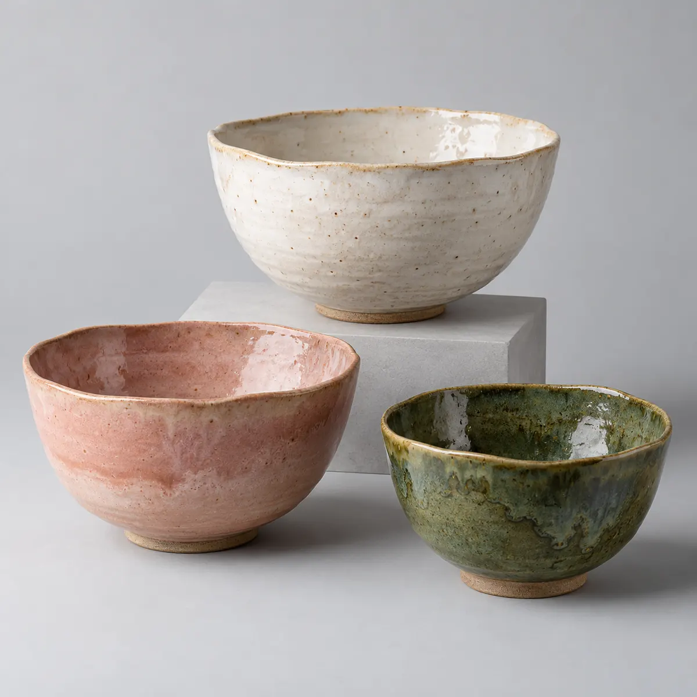
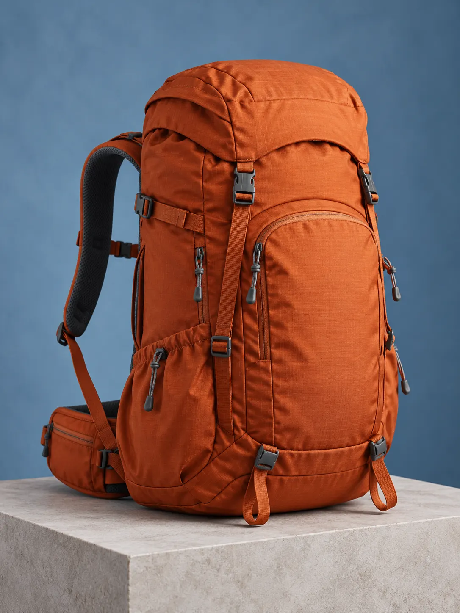
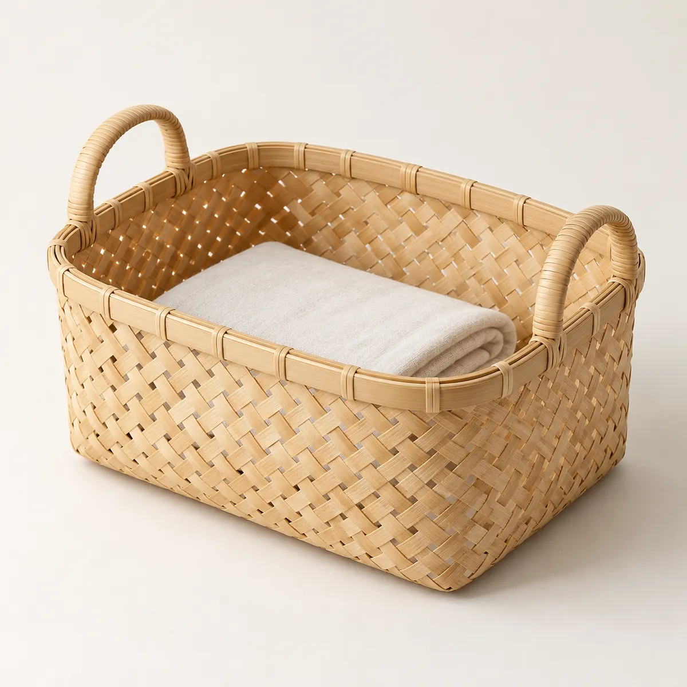
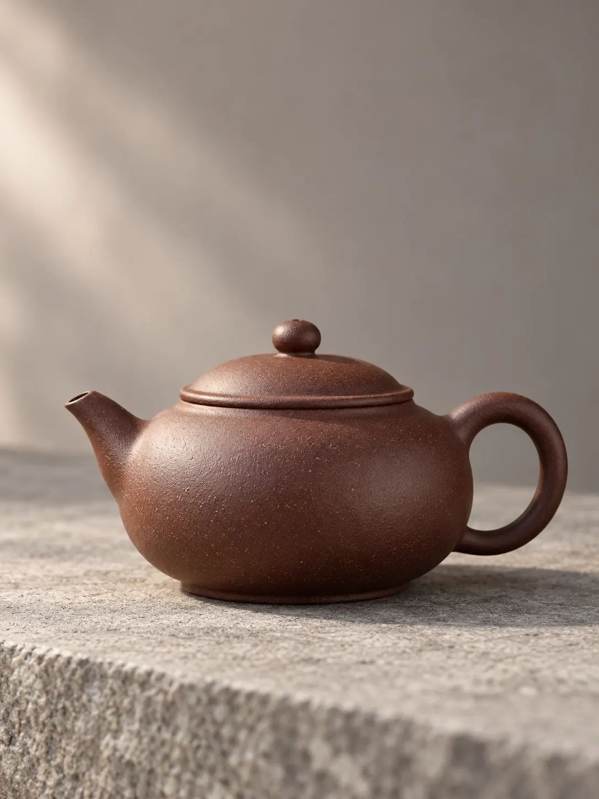
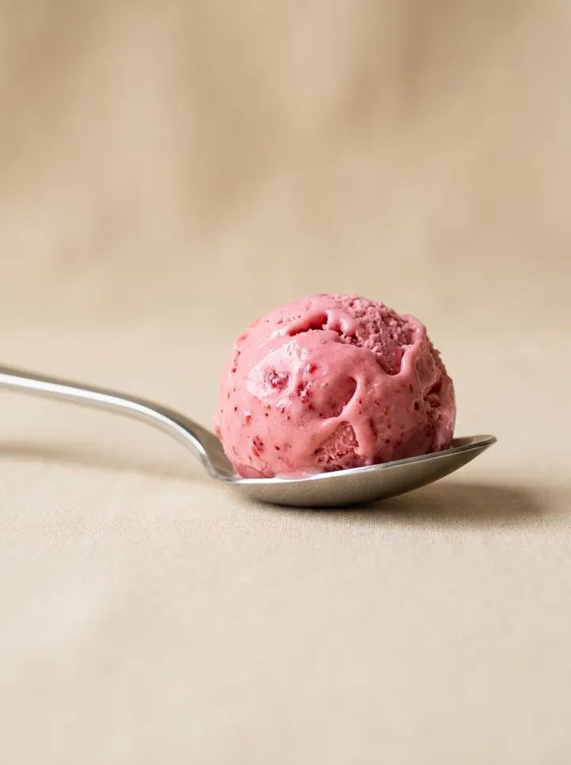

# Clean catalog shots (plain or white background)

商品主图（纯色 / 白底）

Main listing images: one product, plain seamless background, soft even light, real contact shadow.

列表主图：单个商品、无缝纯色背景、柔和均匀的光、真实的接触阴影。

[Back to README](../README.md) · [中文说明](../README.zh.md)

### Ceramic Bowl Collection



```text
Create a clean catalog photograph of three original handmade ceramic bowls in chalk white, clay pink and moss green, arranged at different heights on a seamless light-gray background. Show glaze variation and believable contact shadows, crisp edges, broad softbox lighting. No food, people, text, logos or recognizable branded patterns.
```

- Type: text-to-image
- Aspect ratio: `1:1`
- Model preset on the source page: `gpt-image-2`
- Source: `image2ai.cloud/templates/product-photos`

### Trail Backpack Detail



```text
Photograph a single unbranded rust-orange hiking backpack standing on a pale stone studio plinth. Three-quarter view, believable woven fabric, visible stitching, straps and zipper pulls, soft directional light and a muted blue background. Keep the entire bag inside the frame. No people, labels, text, logos or recognizable branded design.
```

- Type: text-to-image
- Aspect ratio: `3:4`
- Model preset on the source page: `gpt-image-2`
- Source: `image2ai.cloud/templates/product-photos`

### 竹编收纳篮主图



```text
原创电商商品摄影，一只无品牌的浅色竹编收纳篮放在米白无缝背景上，四分之三视角，完整展示篮口、提手和细密编织纹理，篮内只放一块折叠素色棉布，柔和棚拍光，真实接触阴影，画面干净。不要人物、文字、标签、品牌标志、水印或可识别的品牌专属造型。
```

- Type: text-to-image
- Prompt language: Chinese (shown as used on the site). What it shows: 竹编收纳篮置于浅色背景上，呈现竹条纹理与编织细节
- Aspect ratio: `1:1`
- Model preset on the source page: `gpt-image-2`
- Source: `image2ai.cloud/zh/templates/product-photos`

### 手工茶壶细节图



```text
原创商品摄影，一把无品牌的紫砂小茶壶放在浅灰石台上，壶盖正常合拢，壶嘴与把手完整入镜，侧后方柔光表现细腻砂粒和温润质感，背景为低饱和暖灰，不摆茶杯，不加装饰文字。不要人物、印章、款识、品牌标志、水印或知名器型的直接复制。
```

- Type: text-to-image
- Prompt language: Chinese (shown as used on the site). What it shows: 手工茶壶的壶身、壶嘴与釉面细节
- Aspect ratio: `3:4`
- Model preset on the source page: `gpt-image-2`
- Source: `image2ai.cloud/zh/templates/product-photos`

### 冰淇淋商品静物



```text
极简静物商品图：银色勺子上一球粉色草莓冰淇淋，暖米色纯色背景，柔和侧光，浅景深，干净的电商风格
```

- Type: text-to-image
- Prompt language: Chinese (shown as used on the site). What it shows: 极简商品图：银色勺子上一球粉色草莓冰淇淋，暖米色纯色背景
- Aspect ratio: `3:4`
- Model preset on the source page: `nano-banana-2`
- Source: `image2ai.cloud/zh/templates/product-photos`
