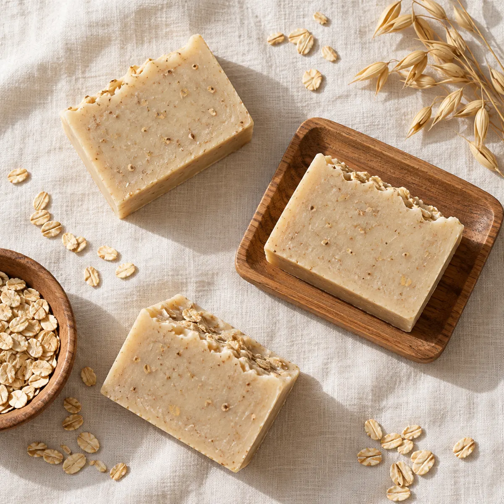
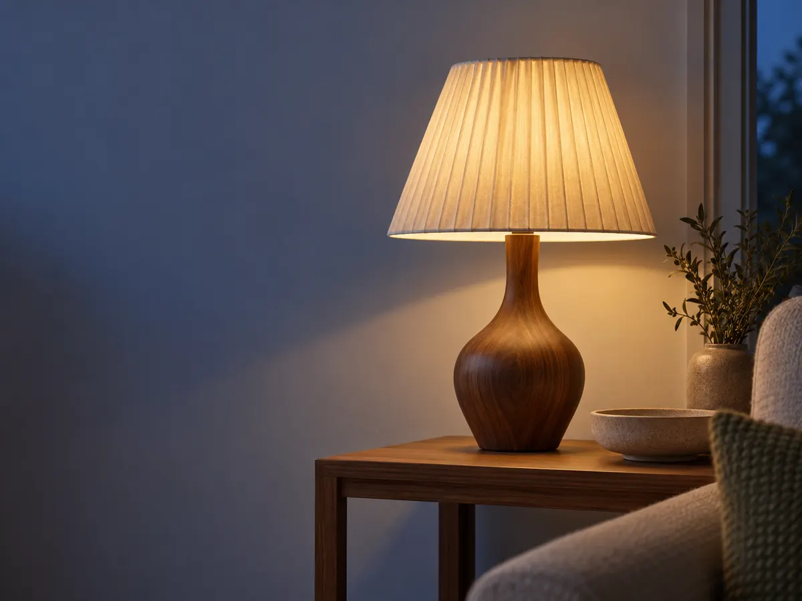
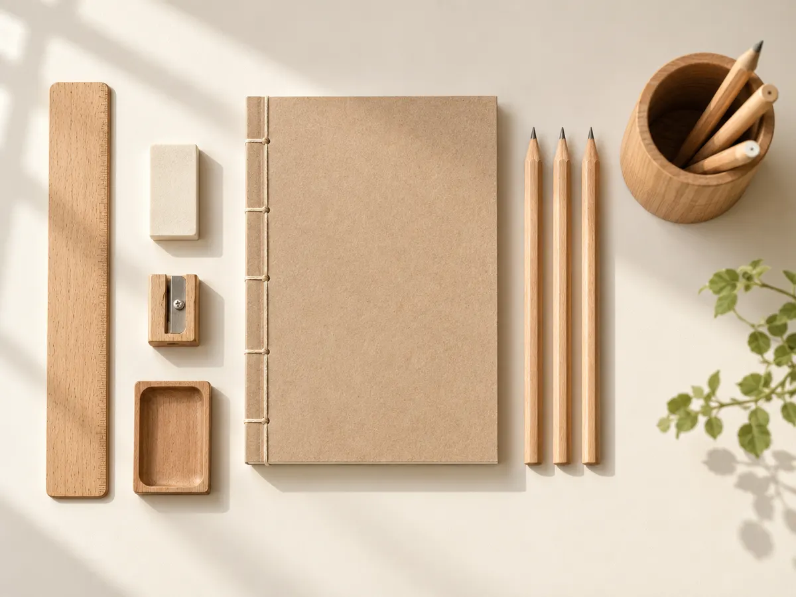

# Lifestyle scenes and flat lays

场景图与俯拍

Show the product in use or in a styled setting: flat lays, interiors, mood lighting.

把商品放进使用场景或布景里：俯拍、室内、氛围光。

[Back to README](../README.md) · [中文说明](../README.zh.md)

### Handmade Soap Flat Lay



```text
Create an original overhead product photograph of three unbranded handmade oat soap bars on ivory linen, with scattered oats and a small wooden tray. Show the cut texture clearly, soft morning side light, warm neutral colors, generous space between objects. No people, packaging text, logos, watermarks or recognizable branded shapes.
```

- Type: text-to-image
- Aspect ratio: `1:1`
- Model preset on the source page: `gpt-image-2`
- Source: `image2ai.cloud/templates/product-photos`

### Sculptural Table Lamp



```text
Create an original interior product photograph of an unbranded sculptural table lamp with a cream pleated shade and walnut base on a simple side table. Warm lamp glow against a cool dusk wall, realistic fabric and wood grain, restrained styling, empty space to the left. No people, lettering, logos or recognizable designer-product replicas.
```

- Type: text-to-image
- Aspect ratio: `4:3`
- Model preset on the source page: `gpt-image-2`
- Source: `image2ai.cloud/templates/product-photos`

### Perfume on wet stones


```text
Unbranded amber glass perfume bottle on wet black stones, gentle ripples, warm rim light and teal background glow, luxury ad look, empty space on the left for copy
```

- Type: text-to-image
- Aspect ratio: `16:9`
- Model preset on the source page: `nano-banana-pro`
- Source: `image2ai.cloud/templates/product-photos`

### 原木文具俯拍



```text
原创电商俯拍图，一套无品牌原木文具整齐摆在暖白桌面上，包括木尺、无字封面的线装笔记本、素色铅笔和小号木笔筒，各物件之间留出清晰间隔，柔和窗光，真实木纹，克制的米棕配色。尺面不写数字，笔记本与铅笔不写字，不要人物、品牌标志或水印。
```

- Type: text-to-image
- Prompt language: Chinese (shown as used on the site). What it shows: 原木文具整齐排列的俯拍静物
- Aspect ratio: `4:3`
- Model preset on the source page: `gpt-image-2`
- Source: `image2ai.cloud/zh/templates/product-photos`
