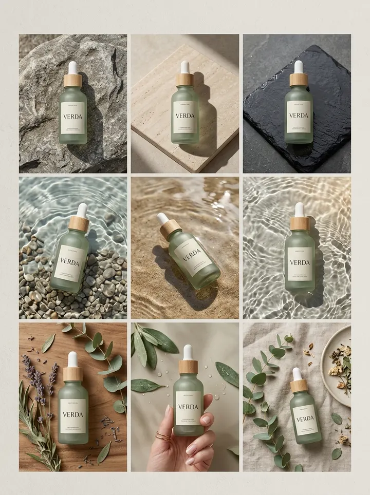
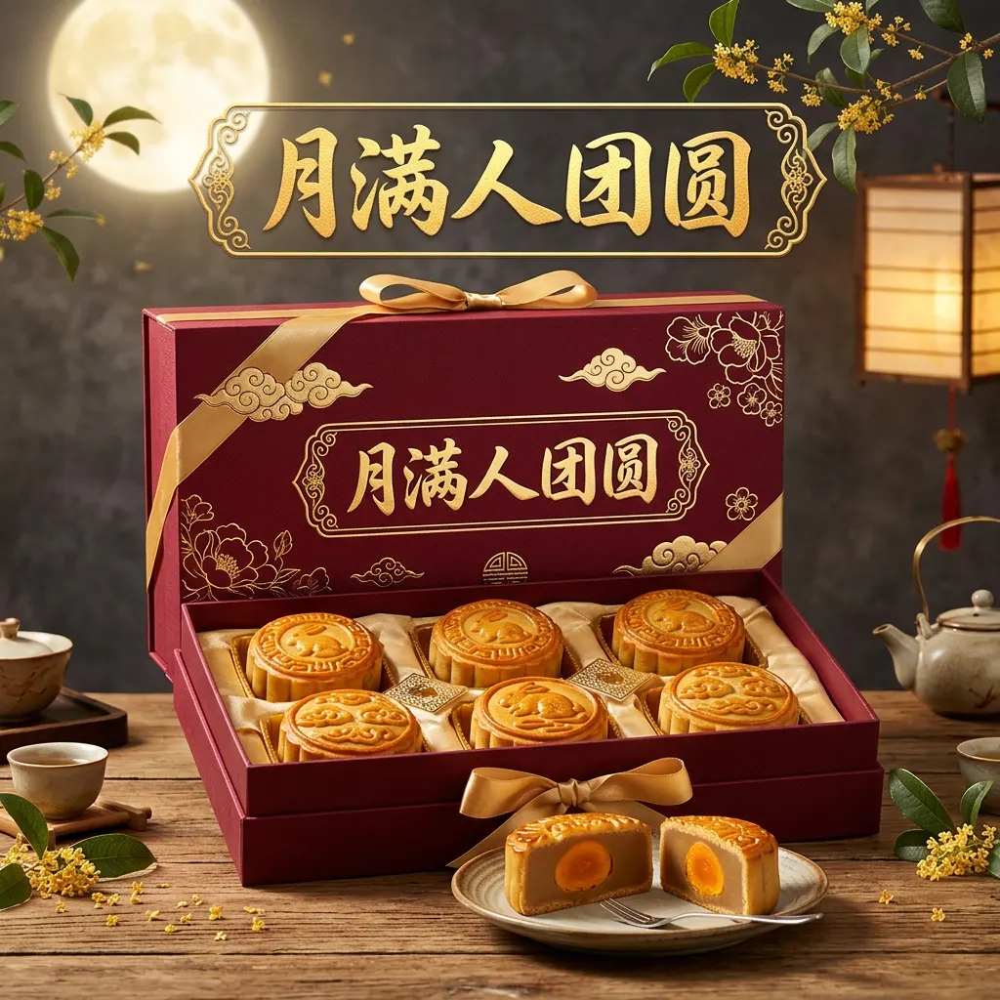

# Mockup sets and holiday gift shots

多场景套图与节日礼盒

One product across several scenes in one image, and seasonal gift-box key visuals.

一张图里出同一商品的多个场景，以及节日礼盒主图。

[Back to README](../README.md) · [中文说明](../README.zh.md)

### Skincare mockup grid



```text
3x3 grid of designer mockups for one frosted sage-green dropper bottle labeled "VERDA": on stone, in water, with botanicals, in hand, flat lay
```

- Type: text-to-image
- Aspect ratio: `3:4`
- Model preset on the source page: `nano-banana-2`
- Source: `image2ai.cloud/templates/product-photos`

### 中秋月饼礼盒主图



```text
中秋月饼礼盒电商主图：深红礼盒配金色云纹，六个金黄月饼，切开一个看到莲蓉和咸蛋黄，背景圆月和桂花，金色书法“月满人团圆”
```

- Type: text-to-image
- Prompt language: Chinese (shown as used on the site). What it shows: 深红色中秋月饼礼盒电商主图，盒里六个金黄月饼，背景圆月，金色书法“月满人团圆”
- Aspect ratio: `1:1`
- Model preset on the source page: `nano-banana-2`
- Source: `image2ai.cloud/zh/templates/product-photos`
