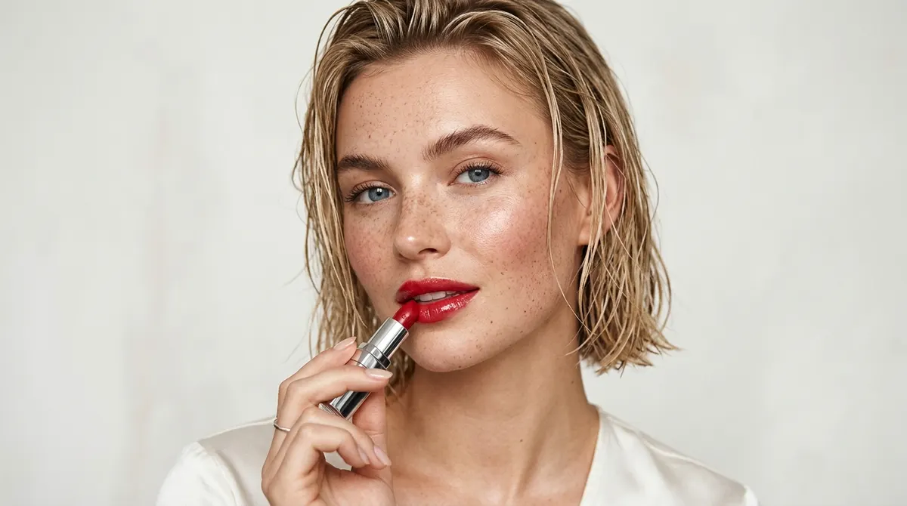
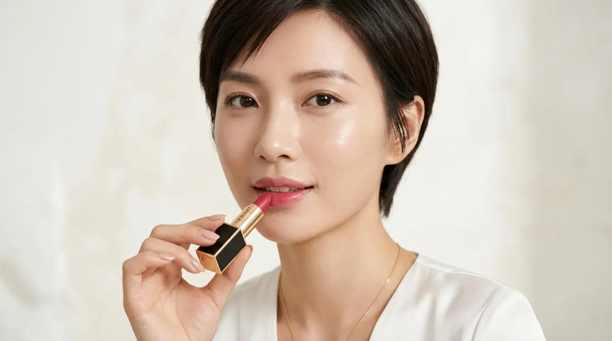

# On-model shots

模特图

Beauty close-ups and putting your garment on a model photo you already have.

美妆特写，以及把你的衣服穿到已有的模特照片上。

[Back to README](../README.md) · [中文说明](../README.zh.md)

### Lipstick beauty close-up



```text
High-end beauty ad close-up: a model with wet-look short blonde hair and freckles holds a silver lipstick near her glossy lips, soft frontal light, off-white background
```

- Type: text-to-image
- Aspect ratio: `16:9`
- Model preset on the source page: `nano-banana-2`
- Source: `image2ai.cloud/templates/product-photos`

### 水光肌美妆特写



```text
美妆广告特写：短发女生手拿口红贴近嘴唇，皮肤水润有光泽，米白背景，柔和正面光，干净高级
```

- Type: text-to-image
- Prompt language: Chinese (shown as used on the site). What it shows: 美妆广告特写：短发女生手拿口红贴近嘴唇，皮肤水润，米白背景
- Aspect ratio: `16:9`
- Model preset on the source page: `nano-banana-2`
- Source: `image2ai.cloud/zh/templates/product-photos`
