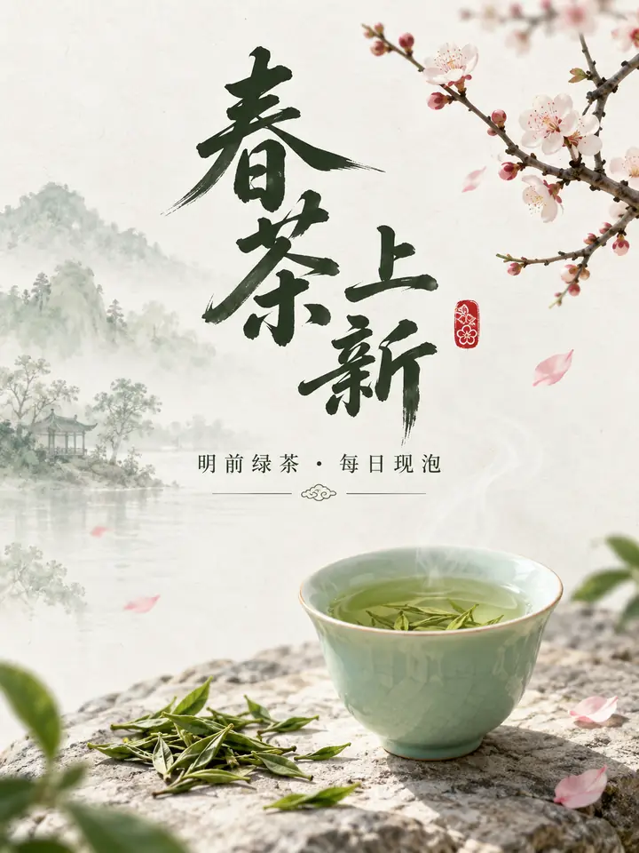
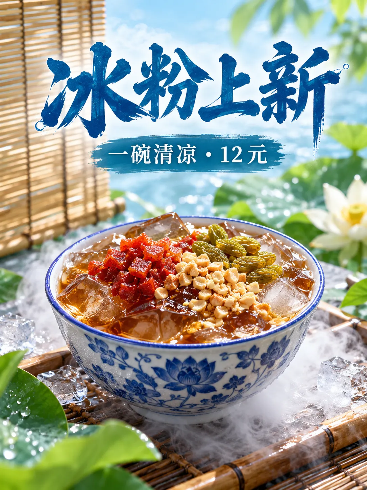

# Shop posters with text (Chinese)

店铺海报（带中文字）

Promotional posters with headline text rendered in the image. Both prompts are in Chinese.

画面里直接出标题文字的促销海报。

[Back to README](../README.md) · [中文说明](../README.zh.md)

### 新中式春茶海报



```text
新中式茶饮海报：青瓷杯里的绿茶冒着热气，米色宣纸背景，几片茶叶和一枝梅花，书法大标题“春茶上新”，小字“明前绿茶 · 每日现泡”，红色印章点缀，大量留白
```

- Type: text-to-image
- Prompt language: Chinese (shown as used on the site). What it shows: 新中式茶饮海报：青瓷杯里冒热气的绿茶，宣纸底上书法标题“春茶上新”和红色印章
- Aspect ratio: `3:4`
- Model preset on the source page: `gpt-image-2`
- Source: `image2ai.cloud/zh/templates/posters`

### 夏日冰粉新品海报



```text
夏日甜品店新品海报：青花瓷碗里一份红糖冰粉，配山楂碎、葡萄干和花生碎，碗边冒着冷气，背景是竹帘和绿荷叶，大字“冰粉上新”，小字“一碗清凉 · 12 元”，清爽蓝绿配色
```

- Type: text-to-image
- Prompt language: Chinese (shown as used on the site). What it shows: 青花瓷碗里的红糖冰粉，大字“冰粉上新”
- Aspect ratio: `3:4`
- Model preset on the source page: `gpt-image-2`
- Source: `image2ai.cloud/zh/templates/posters`
